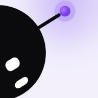

### Hi, I'm Steven 👋

Software engineer at [Welcome to the Jungle](https://www.welcometothejungle.com/), building products with AI.

#### Apps in production

-  **[Kinglet](https://getkinglet.com)**: the dev environment for vibe coding
-  **[Backslash](https://www.getbackslash.com)**: a keyboard-first launcher for Linux ([open source](https://github.com/backslash-app/backslash))
-  **[BoardGameBlob](https://www.boardgameblob.com)**: board game rules, answered by Blob
-  **[BoardGameBase](https://boardgamebase.com)**: an open board game reference in 5 languages
-  **[BoardGameTag](https://boardgametag.com)**: run a board game swap meet, even offline
-  **[BoardGameClan](https://boardgameclan.com)**: organise your gaming group and game nights

#### Find me

[LinkedIn](https://linkedin.com/in/stevenpersia) · [X](https://x.com/stevenpersia_js) · [Twitch](https://twitch.tv/stevenpersia)
