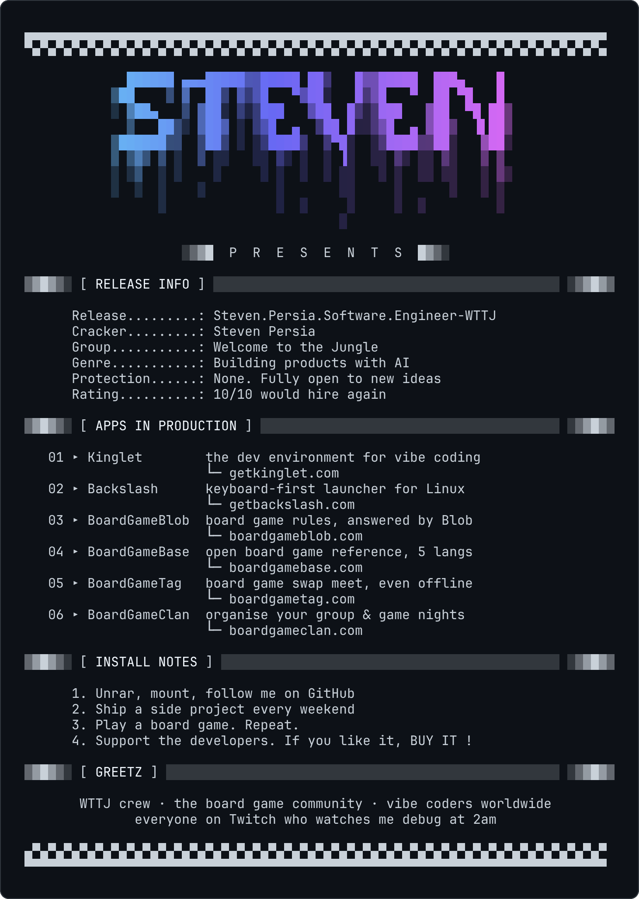

 [Kinglet](https://getkinglet.com) ·
 [Backslash](https://www.getbackslash.com) ([open source](https://github.com/backslash-app/backslash)) ·
 [BoardGameBlob](https://www.boardgameblob.com) ·
 [BoardGameBase](https://boardgamebase.com) ·
 [BoardGameTag](https://boardgametag.com) ·
 [BoardGameClan](https://boardgameclan.com)

[LinkedIn](https://linkedin.com/in/stevenpersia) · [X](https://x.com/stevenpersia_js) · [Twitch](https://twitch.tv/stevenpersia)
