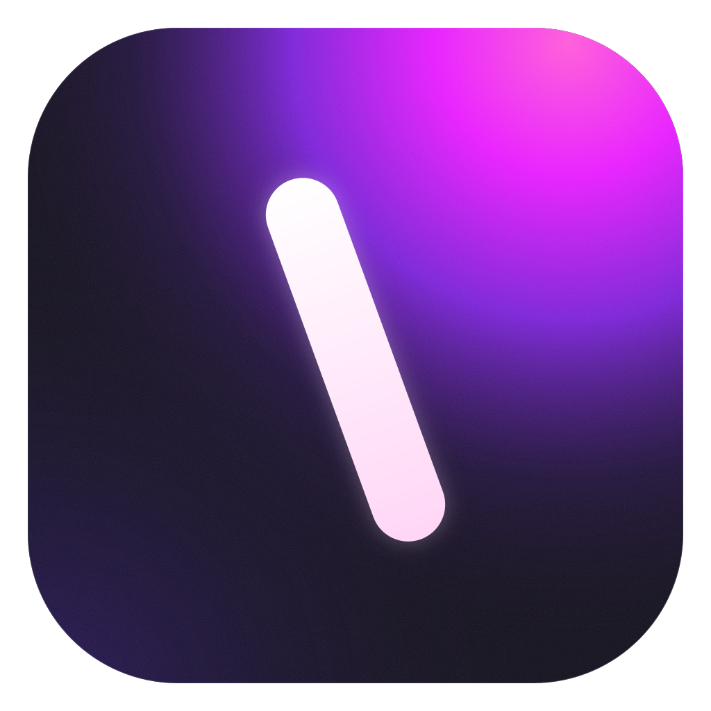
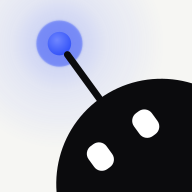

```
▄▄▄▄▄▄▄▄▄▄▄▄▄▄▄▄▄▄▄▄▄▄▄▄▄▄▄▄▄▄▄▄▄▄▄▄▄▄▄▄▄▄▄▄▄▄▄▄▄▄▄▄▄▄▄▄▄▄▄▄▄▄▄▄▄▄▄▄▄▄▄▄▄▄
▀▀▀▀▀▀▀▀▀▀▀▀▀▀▀▀▀▀▀▀▀▀▀▀▀▀▀▀▀▀▀▀▀▀▀▀▀▀▀▀▀▀▀▀▀▀▀▀▀▀▀▀▀▀▀▀▀▀▀▀▀▀▀▀▀▀▀▀▀▀▀▀▀▀

           ███████╗████████╗███████╗██╗   ██╗███████╗███╗   ██╗
           ██╔════╝╚══██╔══╝██╔════╝██║   ██║██╔════╝████╗  ██║
           ███████╗   ██║   █████╗  ██║   ██║█████╗  ██╔██╗ ██║
           ╚════██║   ██║   ██╔══╝  ╚██╗ ██╔╝██╔══╝  ██║╚██╗██║
           ███████║   ██║   ███████╗ ╚████╔╝ ███████╗██║ ╚████║
           ╚══════╝   ╚═╝   ╚══════╝  ╚═══╝  ╚══════╝╚═╝  ╚═══╝

                ·  ·  ·   P  R  E  S  E  N  T  S   ·  ·  ·

══[ RELEASE INFO ]════════════════════════════════════════════════════════

      Release.........: Steven.Persia.Software.Engineer-WTTJ
      Cracker.........: Steven Persia
      Group...........: Welcome to the Jungle
      Genre...........: Building products with AI
      Protection......: None. Fully open to new ideas
      Rating..........: 10/10 would hire again

══[ APPS IN PRODUCTION ]══════════════════════════════════════════════════

   01 > Kinglet        the dev environment for vibe coding
                       └─ getkinglet.com
   02 > Backslash      keyboard-first launcher for Linux
                       └─ getbackslash.com
   03 > BoardGameBlob  board game rules, answered by Blob
                       └─ boardgameblob.com
   04 > BoardGameBase  open board game reference, 5 langs
                       └─ boardgamebase.com
   05 > BoardGameTag   board game swap meet, even offline
                       └─ boardgametag.com
   06 > BoardGameClan  organise your group & game nights
                       └─ boardgameclan.com

══[ INSTALL NOTES ]═══════════════════════════════════════════════════════

      1. Unrar, mount, follow me on GitHub
      2. Ship a side project every weekend
      3. Play a board game. Repeat.
      4. Support the developers. If you like it, BUY IT !

══[ GREETZ ]══════════════════════════════════════════════════════════════

       WTTJ crew · the board game community · vibe coders worldwide
              everyone on Twitch who watches me debug at 2am

▄▄▄▄▄▄▄▄▄▄▄▄▄▄▄▄▄▄▄▄▄▄▄▄▄▄▄▄▄▄▄▄▄▄▄▄▄▄▄▄▄▄▄▄▄▄▄▄▄▄▄▄▄▄▄▄▄▄▄▄▄▄▄▄▄▄▄▄▄▄▄▄▄▄
▀▀▀▀▀▀▀▀▀▀▀▀▀▀▀▀▀▀▀▀▀▀▀▀▀▀▀▀▀▀▀▀▀▀▀▀▀▀▀▀▀▀▀▀▀▀▀▀▀▀▀▀▀▀▀▀▀▀▀▀▀▀▀▀▀▀▀▀▀▀▀▀▀▀
```

 [Kinglet](https://getkinglet.com) ·
 [Backslash](https://www.getbackslash.com) ([open source](https://github.com/backslash-app/backslash)) ·
 [BoardGameBlob](https://www.boardgameblob.com) ·
 [BoardGameBase](https://boardgamebase.com) ·
 [BoardGameTag](https://boardgametag.com) ·
 [BoardGameClan](https://boardgameclan.com)

[LinkedIn](https://linkedin.com/in/stevenpersia) · [X](https://x.com/stevenpersia_js) · [Twitch](https://twitch.tv/stevenpersia)
